# Práctica 5 — Balanceo de carga en Sudcali

Equipo: Jorge Eduardo Alvarez Aviles, Logan Ransseth Rios Manriquez, Omar Alberto Rios Aviles

Un balanceador Nginx reparte entre dos nodos con la misma aplicación y una base de datos compartida. Cada nodo es un contenedor de Docker con su propia IP. La elección del algoritmo se razona en [balanceoCarga.md](balanceoCarga.md).

## Diagrama

```
                      Navegador / ab
                            │
                127.0.0.1:8080 (HTTP) · :8443 (HTTPS)
                            │
              ┌─────────────▼─────────────┐
              │ balanceador  172.28.0.10  │  nginx:1.27
              └──────┬─────────────┬──────┘
                     │             │         round robin o least_conn
        ┌────────────▼───┐   ┌─────▼──────────┐
        │ app1           │   │ app2           │  Laravel, php:8.5
        │ 172.28.0.11    │   │ 172.28.0.12    │
        │ :8000  NODO=1  │   │ :8000  NODO=2  │
        └────────┬───────┘   └───────┬────────┘
                 │                   │
              ┌──▼───────────────────▼──┐
              │ db  172.28.0.13 :3306   │  mysql:8.4 (datos y sesiones)
              └─────────────────────────┘
```

Solo el balanceador tiene puerto hacia el equipo. Los nodos y la base no se alcanzan desde fuera de la red de Docker.

## Cómo cumple lo que pide la práctica

| Requisito | Cómo se resuelve | Dónde |
| --- | --- | --- |
| Tres nodos, cada uno con su dirección | Balanceador y dos nodos en contenedores con IP fija | [compose.yml](../compose.yml) |
| La misma versión en los dos nodos | Los dos salen del mismo `Dockerfile`; solo cambia `NODO` | [Dockerfile](../Dockerfile) |
| Una sola base de datos | Contenedor `db`, con MySQL | `compose.yml` |
| Cada nodo se identifica | Cabecera `X-Servidor` (la pone Laravel) y `X-Nodo` (la pone Nginx) | `IdentificarNodo`, [balanceo.conf](servidor/docker/balanceo.conf) |
| `/salud` revisa algo real | Consulta la base; si no contesta, 503 | `SaludController` |
| La sesión sobrevive al cambio de nodo | `SESSION_DRIVER=database` en la base compartida y la misma `APP_KEY` | `compose.yml` |
| Confiar en el balanceador | Solo en 172.28.0.10, no en `*` | `TRUSTED_PROXIES` |
| Dos algoritmos | Round robin y least_conn, con `ALGORITMO` | [servidor/docker/](servidor/docker/) |
| Mediciones con Apache Bench | Escenarios automáticos con `-l`, calentamiento y tres corridas | [medir.mjs](servidor/medir.mjs) |

**Lo que cambiamos de la plantilla, y por qué**

- **PHP 8.5 en vez de 8.3:** nuestro `composer.lock` exige 8.4.1 o superior. También hace falta la extensión `zip` para los reportes de Excel.
- **Sin contraseñas en `compose.yml`:** salen de `.env` (Práctica 6).
- **`X-Forwarded-For` se sobrescribe** con `$remote_addr`. Con `$proxy_add_x_forwarded_for` se conservaría lo que mande el cliente.
- **Volumen compartido para las imágenes subidas:** si cada nodo guardara las suyas, una foto subida en uno no se vería en el otro.
- **Volumen para la bitácora:** sin él se perdía al recrear un contenedor.
- **`zone` en el upstream:** para que los procesos de Nginx compartan lo que saben de cada nodo (ver «Lo que encontramos al medir»).
- **Nodos por IP, no por nombre:** Nginx no arranca si el nombre de un contenedor apagado no se puede resolver.
- **Cuatro procesos por nodo** (`PHP_CLI_SERVER_WORKERS=4`), porque `artisan serve` atiende una petición a la vez por proceso.

**Pruebas:** `SaludTest`, 5 de 5. La suite completa se corrió también sobre MySQL 8.0 con el mismo resultado que en SQLite: de 219 pasaban 202, 8 se omiten y 9 fallan (kit de inicio, no se usa). Con `EntregaTest` (mapa, camino y foto de entrega) son 238 de 255 en SQLite.

## Cómo levantarlo

Requiere **Docker Desktop** con WSL 2.

1. En `.env`, agregar una contraseña larga para la base. `APP_KEY` debe existir:

   ```
   DOCKER_DB_PASSWORD=
   DEMO_PASSWORD=
   ```

2. Levantar y crear los datos de demostración. La imagen compila el CSS y el JavaScript:

   ```bash
   docker compose up -d --build
   docker compose run --rm preparar   # borra y crea los datos del contenedor
   ```

3. Comprobar reparto, salud y sesión:

   ```bash
   node docs/servidor/medir.mjs comprobar
   ```

   Debe mostrar los nodos `1` y `2` con cantidades parecidas y terminar con «La sesión sobrevive al cambio de nodo».

El sitio queda en `http://127.0.0.1:8080`. En F12 › Red se ve `X-Servidor` cambiar entre recargas.

| Para… | Comando |
| --- | --- |
| Cambiar a round robin (PowerShell) | `$env:ALGORITMO='round_robin'; docker compose up -d balanceador` |
| Volver a least_conn | `$env:ALGORITMO='least_conn'; docker compose up -d balanceador` |
| Tirar un nodo | `docker compose stop app1` |
| Reincorporarlo | `docker compose start app1` |
| Ver las IP | `docker network inspect sudcali_red` |
| Ver qué pasa | `docker compose logs -f balanceador` |
| Apagar todo | `docker compose down` |

## HTTPS con Docker (Práctica 6, medida 11)

1. Certificado de prueba, en Git Bash desde la raíz del proyecto:

   ```bash
   mkdir -p docs/servidor/docker/certificados
   MSYS_NO_PATHCONV=1 openssl req -x509 -newkey rsa:2048 -nodes -days 7 \
     -keyout docs/servidor/docker/certificados/sudcali.key \
     -out docs/servidor/docker/certificados/sudcali.crt \
     -subj "/CN=sudcali.localhost" -addext "subjectAltName=DNS:sudcali.localhost"
   ```

2. Levantar en modo producción:

   ```bash
   docker compose -f compose.yml -f compose.https.yml up -d --build
   ```

3. Abrir `http://sudcali.localhost:8080/tienda`: debe pasar a `https://sudcali.localhost:8443/tienda`. El aviso del certificado es normal, porque no lo firmó una autoridad conocida.

Para volver al modo de mediciones: `docker compose up -d`. Las mediciones se hacen **sin** HTTPS; en ese modo los nodos redirigen y `ab` mediría la redirección.

## Cómo se mide

```bash
node docs/servidor/medir.mjs medir
```

El programa corre `ab` en su propio contenedor, dentro de la misma red, y hace esto:

| Escenario | Comando |
| --- | --- |
| 1. Un nodo solo | `ab -l -n 1000 -c 20 http://172.28.0.11:8000/tienda` |
| 2. Balanceador, round robin | `ab -l -n 1000 -c 20 http://172.28.0.10/tienda` |
| 3. Balanceador, least_conn | El mismo, con el otro algoritmo |
| 4. Apagando un nodo | `ab -l -n 20000 -c 20 http://172.28.0.10/tienda` y `docker compose stop app1` a media prueba |

- Usa las mismas `-n` y `-c` en los tres primeros, descarta una corrida de calentamiento y repite tres veces. En la tabla va la mediana; todas las salidas quedan en `docs/mediciones/`.
- Mide `/tienda` y no `/`, porque `/` solo redirige al login: se mediría la redirección y no la aplicación.
- Anota también las respuestas **No 2xx**, que `ab` no cuenta como fallidas. Un 502 no aparecería en *Failed requests*.

## Resultados

<!-- resultados:inicio -->
Medido el 24/11/2026, 4:15:45 p.m. en un solo equipo: AMD Ryzen 9 8940HX with Radeon Graphics, 32 hilos, 15 GB. Página: `/tienda`. Cada fila es la mediana de 3 corridas, después de una de calentamiento.

| Escenario | -n / -c | Por segundo | 50 % | 90 % | 99 % | Fallidas | No 2xx | Evidencia |
| --- | --- | --- | --- | --- | --- | --- | --- | --- |
| Un nodo solo | 1000 / 20 | 191.13 | 103 ms | 112 ms | 119 ms | 0 | 0 | [salida](mediciones/nodo-solo-3.txt) |
| Con balanceador (round robin) | 1000 / 20 | 331.56 | 63 ms | 79 ms | 94 ms | 0 | 0 | [salida](mediciones/round-robin-3.txt) |
| Con balanceador (least_conn) | 1000 / 20 | 330.58 | 61 ms | 82 ms | 94 ms | 0 | 0 | [salida](mediciones/least-conn-3.txt) |
| Apagando un nodo | 20000 / 20 | 190.86 | 98 ms | 192 ms | 335 ms | 0 | 0 | [salida](mediciones/caida-1.txt) |

Peticiones por segundo de cada corrida:

| Escenario | 1 | 2 | 3 |
| --- | --- | --- | --- |
| Un nodo solo | 192.94 | 184.97 | 191.13 |
| Round robin | 331.52 | 331.6 | 331.56 |
| least_conn | 332.08 | 330.19 | 330.58 |

Lo que dicen los números:

- **¿Mejoró con el balanceador?** Frente a un nodo solo (191.13/s): round robin +73.5 % y least_conn +73.0 % en peticiones por segundo. El 99 % pasó de 119 ms a 94 ms y 94 ms.
- **¿Qué algoritmo se comportó mejor?** Por el 99 %, los dos tuvieron el mismo 99 % (round robin 94 ms, least_conn 94 ms).
- **¿Cuánto tardó en sacar el nodo caído?** La petición más lenta (100 %) tardó 2260 ms. Fallidas: 0. Respuestas que no fueron 2xx: 0.
<!-- resultados:fin -->

### Capturas

Las del sitio son capturas del navegador. Las de texto son imágenes hechas con la salida original de cada comando, sin editar; los archivos de `ab` están en [mediciones/](mediciones/).

| Qué muestra | Imagen |
| --- | --- |
| Contenedores, IP y puertos | 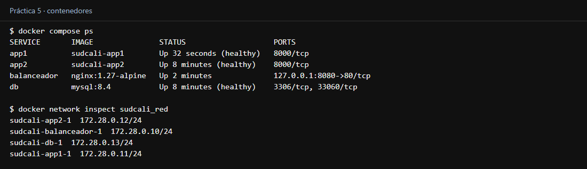 |
| Reparto, salud y sesión en los dos nodos | 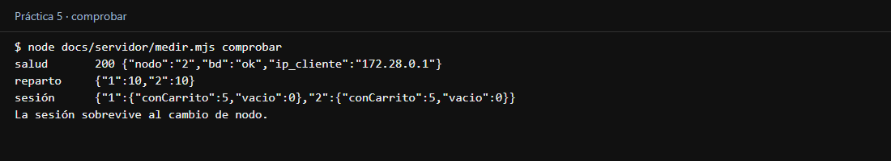 |
| `ab`: un nodo solo | 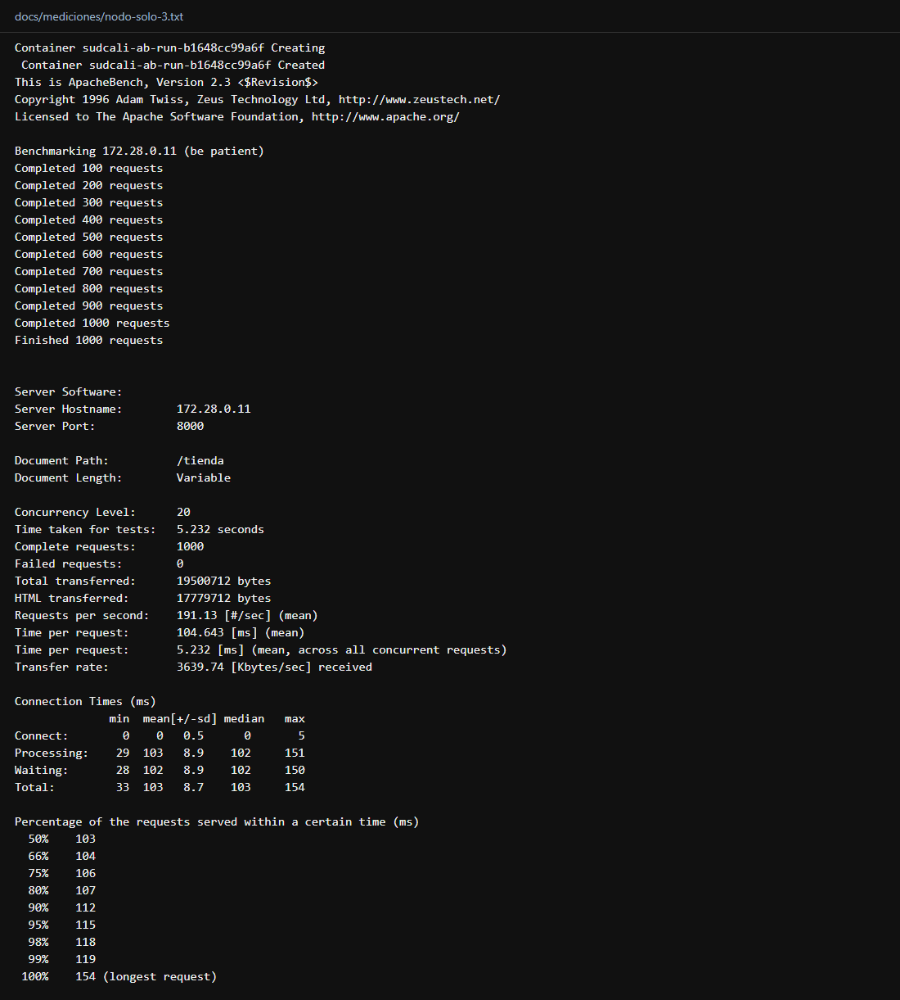 |
| `ab`: round robin | 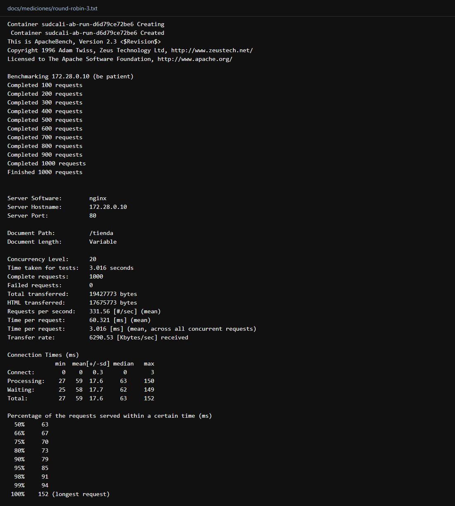 |
| `ab`: least_conn | 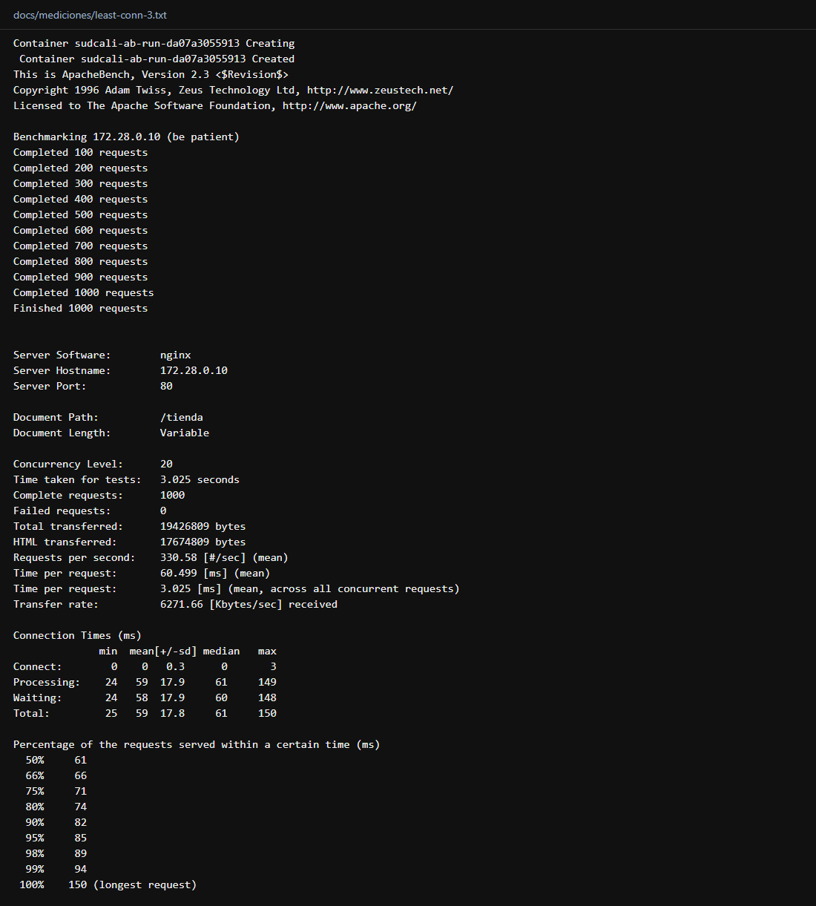 |
| `ab`: apagando un nodo | 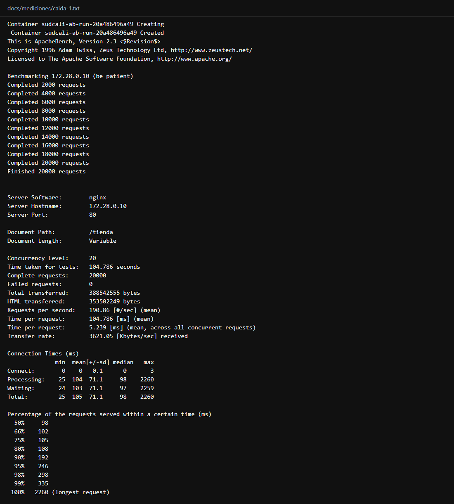 |
| Un nodo apagado y reincorporado, petición por petición | 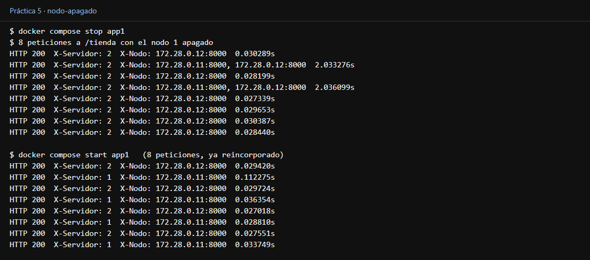 |
| `/salud` responde 503 sin base de datos | 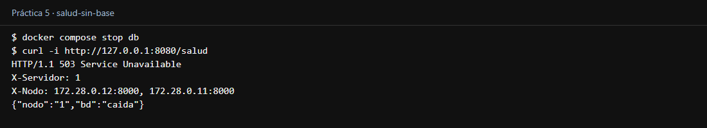 |
| HTTPS: redirección, cabeceras y cookies | 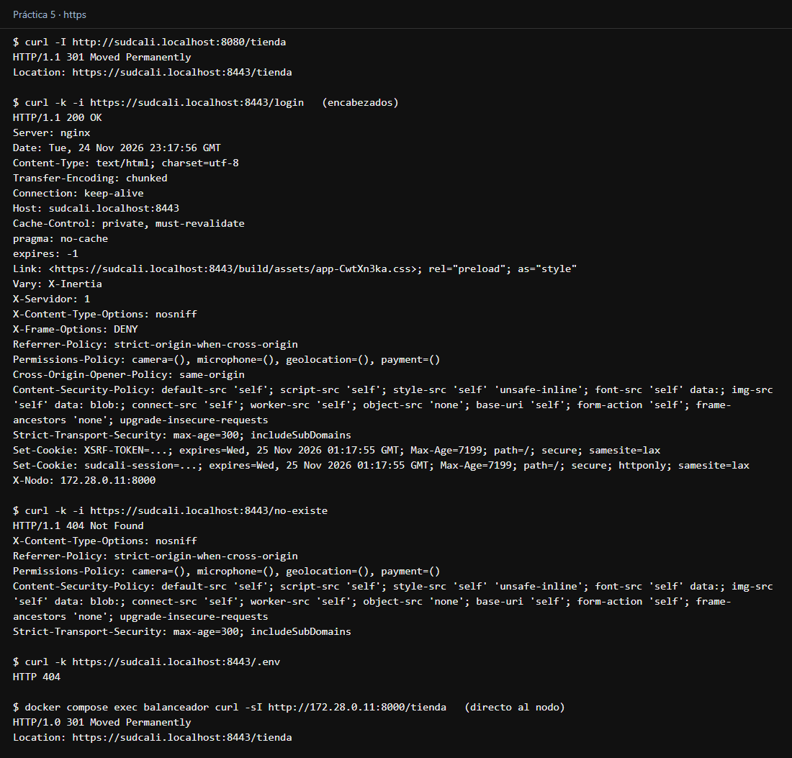 |
| TLS 1.0 y 1.1 rechazados | 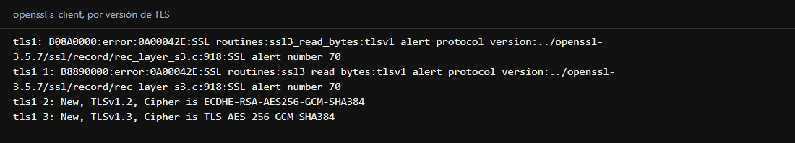 |
| Cookies y CSP en el navegador | 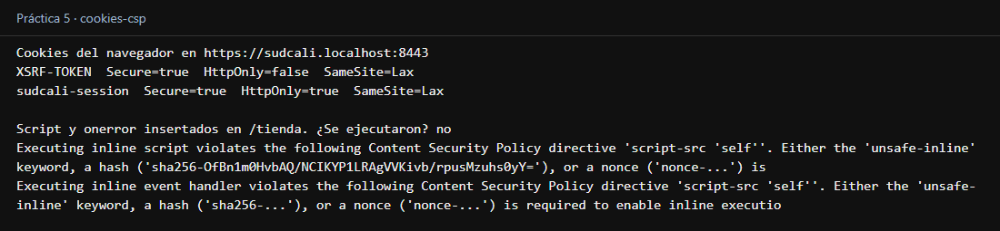 |
| Tienda por HTTPS |  |
| Acceso por HTTPS |  |
| Gerente con sesión en el POS por HTTPS | 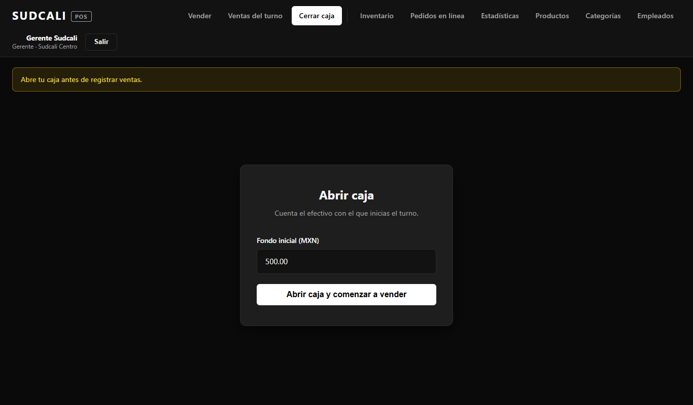 |

### Lo que encontramos al medir

En la primera medición, apagar un nodo dejaba el 99 % en **1961 ms**. La bitácora de Nginx mostró por qué: usa 32 procesos, uno por hilo, y **cada uno descubría al nodo caído por su cuenta**. Los 32 fallaron, 257 veces en total. Agregamos `zone` al upstream para que compartan ese estado y repetimos todo:

| Apagando un nodo (20000 / 20) | Sin `zone` | Con `zone` |
| --- | --- | --- |
| Intentos fallidos hacia el nodo caído | 257 | 6 |
| 99 % | 1961 ms | 335 ms |
| 100 % | 2233 ms | 2260 ms |
| Fallidas | 0 | 0 |

La petición más lenta no mejora porque siempre hay alguna que espera los 2 s de `proxy_connect_timeout`; lo que cambia es **cuántas** la sufren. Las salidas de la primera medición están en [mediciones/sin-zone/](mediciones/sin-zone/).

## Límites de la medición

- Todo corre en un mismo equipo: los dos nodos, la base, el balanceador y `ab` comparten procesador. Aquí la mejora fue grande porque el equipo tiene 32 hilos y cada nodo solo usa 4 procesos: el límite era el nodo, no el procesador.
- `php artisan serve` es un servidor de desarrollo. Los números sirven para comparar escenarios, no para saber cuánto soportaría el sitio publicado.
- La prueba de caída se hizo una vez con cada configuración, no tres.
- Cada petición de `ab` llega sin cookies y crea una sesión en la base. Es un caso más pesado que el de visitantes que navegan.

## Conclusión

**Sí mejoró con el balanceador.** Pasamos de 191 a 331 peticiones por segundo (+73 %) y el 99 % bajó de 119 a 94 ms. No llegó al doble; lo más probable es que influya que los dos nodos comparten la base de datos, pero no lo medimos aparte.

**Los dos algoritmos empataron:** 331.56 y 330.58 por segundo, con el mismo 99 %. Tiene sentido, porque todas las peticiones eran iguales y los nodos también; menos conexiones se distingue cuando unas peticiones tardan mucho más que otras. Nos quedamos con least_conn porque Sudcali mezcla páginas cortas, reportes y WebSocket (ver [balanceoCarga.md](balanceoCarga.md)), pero **esta medición no demuestra que sea mejor**.

**Al apagar un nodo no falló ninguna petición** de 20000. La más lenta tardó 2.26 s: los 2 s que Nginx espera antes de probar con el otro. Tras dos fallos deja de mandarle tráfico durante 10 s. Con un solo nodo el sitio sigue, a la velocidad de un nodo.
